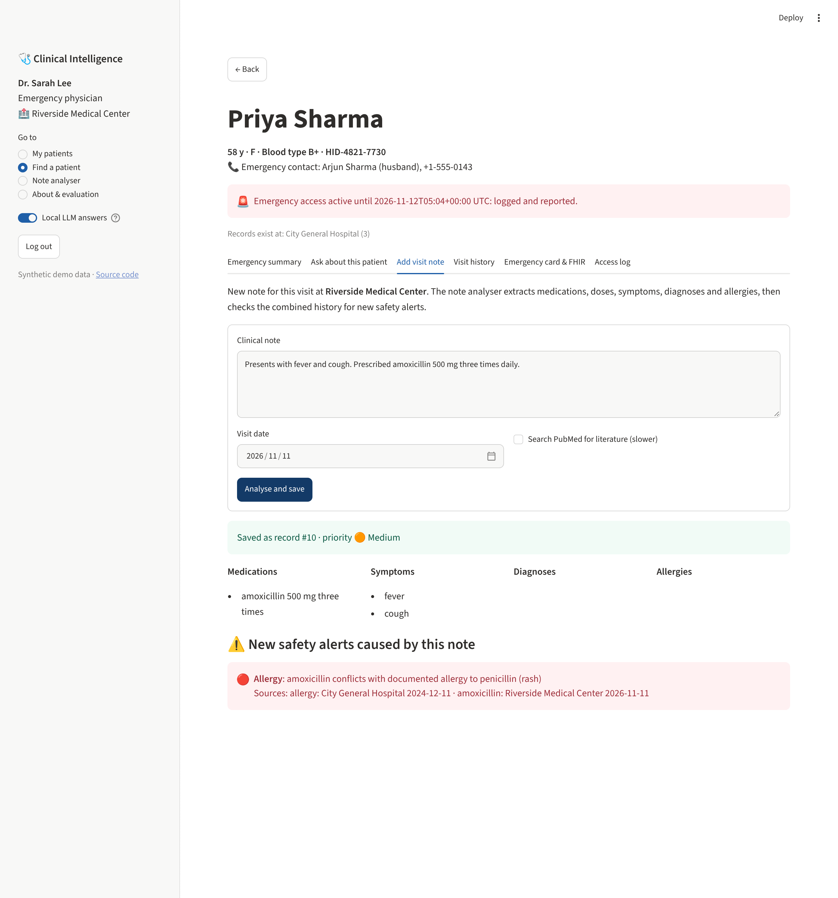
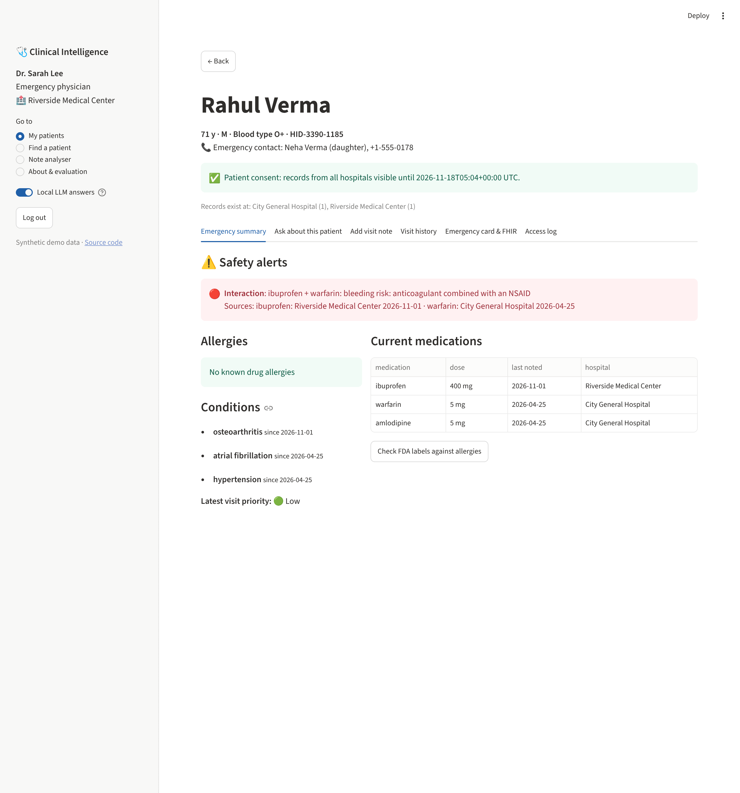
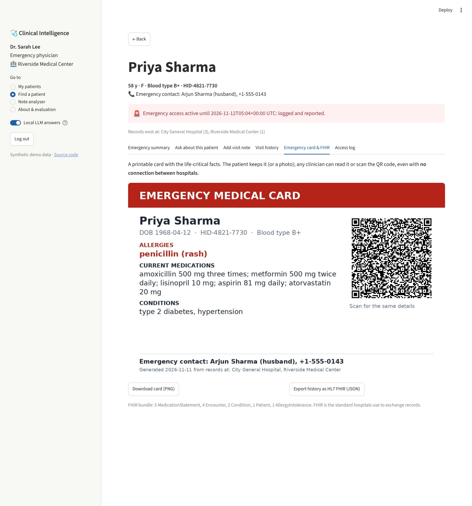

# Clinical Intelligence System

**Private medical history for practitioners, available in an emergency.**

Patients rarely carry their medical history. When they arrive at a different hospital, especially in an emergency, the doctor may not know their **allergies, current medications or conditions**. This system builds each patient's history automatically from clinical notes, lets each hospital keep its own records, and shares them across hospitals **only with patient consent or a logged emergency access**.

> Built as a team project for the Saint Peter's University Academic Symposium.
> **My contributions:** the backend: BERT entity-extraction pipeline, FastAPI API, and PubMed / OpenFDA / RxNorm integration.

**▶ Live demo:** _link added after deployment (see [Run it](#run-it))_. Demo login `dr.lee` / `demo1234`. All patients and notes are fictional.



## The scenario it solves

Priya's whole history is at **City General**. She collapses and is brought to **Riverside**, where Dr. Lee has never seen her.

1. Dr. Lee searches the network by health ID and sees *that* records exist at City General, but not their contents.
2. Priya can't consent, so Dr. Lee uses **emergency access** ("break the glass") with a reason. It's granted for 24 hours, logged, and visible to City General.
3. The **emergency summary** shows: ⚠️ **penicillin allergy (rash)**; metformin, lisinopril, aspirin and atorvastatin with doses; type 2 diabetes and hypertension.
4. Dr. Lee writes a note prescribing amoxicillin. The note analyser flags **"amoxicillin conflicts with documented allergy to penicillin"**.
5. She asks *"Is she on blood thinners?"* → *"Yes: aspirin 81 mg daily [City General Hospital, 2026-10-02]"*.

## Features

| | What it does |
|---|---|
| **1. Patient history** | Notes from every visit are analysed and combined into one summary: allergies, current medications with doses (and older ones), conditions, visit timeline |
| **2. Privacy** | Practitioner login (PBKDF2-hashed passwords, signed API tokens). Staff see their own hospital's records; clinical data endpoints require login |
| **3. Cross-hospital sharing** | Record locator; **patient consent** with a one-time code (simulated SMS, 7 days); **emergency access** with a reason (24 h, flagged); full **access log**; export in **HL7 FHIR R4** |
| **4. Safety alerts** | Allergy vs. drug (incl. drug classes, e.g. penicillin → amoxicillin), interactions (e.g. warfarin + NSAID), duplicate drugs, **different doses at different hospitals**, FDA label check against the patient's allergies |
| **5. Ask about the patient** | Direct, sourced answers for common emergency questions and "Can I give X?" safety checks; other questions use a **local LLM** (Qwen2.5-Instruct, runs on the server) with guardrails |
| **6. Emergency card** | Printable card with a QR code holding the critical facts: readable with no system connection |
| **Note analyser** | BERT NER (Hugging Face) + rules: medications with doses, symptoms, diagnoses, **allergies**, severity flag; grounding in **RxNorm, OpenFDA, PubMed** |

<p>


</p>

## How the LLM is kept honest

Small models invent things. In testing, one answered *"No"* to "Does she smoke?" when nothing was recorded, and another explained a prescription with a reason that wasn't in the notes. So answers are layered:

1. **Direct answers from the structured history** for allergies, medications, blood thinners, conditions, last visit, and "can I give X?". No LLM.
2. **Evidence retrieval**: sentence embeddings (all-MiniLM-L6-v2) over the patient's *accessible* notes only. Nothing relevant → "Not documented"; the LLM is never asked.
3. **"Why" questions** without a stated reason → "The record does not state the reason."
4. **Local LLM** phrases an answer from the evidence; a **grounding check** rejects it if it adds drugs, conditions, numbers or other content words not in the evidence.
5. **Source sentences are always shown.**

The LLM runs locally so patient data is not sent to an outside AI company.

## Architecture

```
clinical note ─► Note analyser (BERT NER + allergy rules + severity) ─► RxNorm / OpenFDA / PubMed
                                    │
                                    ▼
            SQLite: Hospital · Practitioner · Patient · Registration · ClinicalRecord
                    AccessGrant (consent / emergency) · ConsentRequest (OTP) · AccessLog
                                    │
     access control (own hospital │ consent │ emergency) ─► only visible records leave this layer
                                    │
          ┌──────────────┬──────────┴─────────┬───────────────┬──────────────┐
      summary +      patient Q&A         FHIR R4 export    emergency card   access log
    safety alerts  (rules → retrieval
                    → guarded local LLM)
```

Interfaces: **Streamlit app** (`streamlit_app/app.py`) and a **FastAPI** backend (`/auth/login`, `/patients/...`; docs at `/docs`).

## Note analyser evaluation

30 hand-labelled notes (133 entities), BERT pipeline vs. keyword baseline. Strict = exact match; relaxed = partial ("diabetes" ≈ "type 2 diabetes").

| Category | Precision | Recall | F1 (strict) | F1 (relaxed) | Keyword baseline F1 |
|---|---|---|---|---|---|
| Medications | 0.94 | 0.94 | **0.94** | 0.97 | 0.06 |
| Symptoms | 0.67 | 0.62 | **0.65** | 0.90 | 0.33 |
| Diagnoses | 0.75 | 0.64 | **0.69** | 0.89 | 0.16 |
| **Overall** | 0.76 | 0.71 | **0.73** | 0.91 | 0.22 |

Small, synthetic test set: treat as indicative. Reproduce with `python -m evaluation.evaluate`.

## Run it

```bash
python -m venv .venv && source .venv/bin/activate
pip install torch --index-url https://download.pytorch.org/whl/cpu
pip install -r requirements.txt streamlit pandas
streamlit run streamlit_app/app.py          # demo data is created on first start
```

API instead: `uvicorn backend.app.main:app --reload`, then `POST /auth/login` and use the token as `Authorization: Bearer <token>`.

**Deploy free on Streamlit Community Cloud:** repository `malihashaik68/clinical-intelligence-system`, branch `main`, main file `streamlit_app/app.py`. First start takes a few minutes (models download). If the app runs out of memory, add `QA_USE_LLM = "0"` in the app's Secrets (answers then come from rules + retrieval), or host on Hugging Face Spaces (more memory). Settings: `QA_LLM_MODEL` (default `Qwen/Qwen2.5-0.5B-Instruct`; `Qwen/Qwen2.5-1.5B-Instruct` phrases better), `APP_SECRET_KEY` for API tokens.

## Tests

```bash
pytest -q
```

35 tests, under 2 seconds, no model downloads: access control (other hospitals denied, one-time codes, emergency reason required, logging), summaries and alerts, Q&A guardrails, FHIR bundle, emergency card, API authentication, plus the note-analyser tests. GitHub Actions runs them on every push.

## Limitations (and what a real deployment needs)

- **Demo, not a medical device**: fictional data; a real system needs regulatory compliance (HIPAA, India's DPDP Act), certified security, real identity verification and SMS delivery, and integration with hospital systems (FHIR APIs).
- Hospitals are simulated in one database; in production each hospital's records would stay on its own servers and travel as FHIR.
- Drug-safety rules are a small curated set, not a complete interaction database. No negation handling ("denies fever").
- The React dashboard in `frontend/` is from the earlier note-analyser version and has not been updated for login.

## Tech stack

Python · FastAPI · Streamlit · Hugging Face Transformers (BERT NER, Qwen2.5 local LLM) · Sentence-Transformers · PyTorch · SQLAlchemy / SQLite · HL7 FHIR · RxNorm, OpenFDA, PubMed APIs · ChromaDB · qrcode / Pillow · pytest · GitHub Actions
