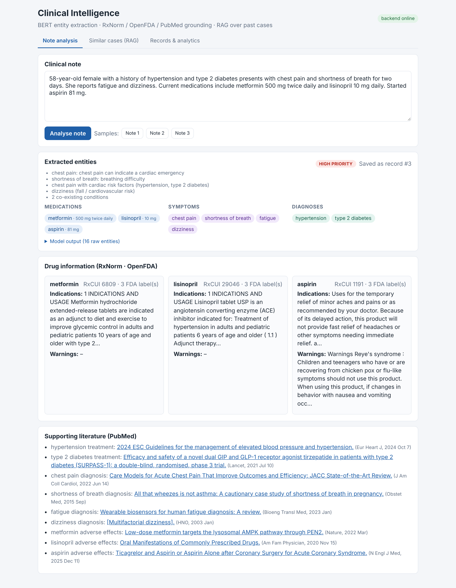
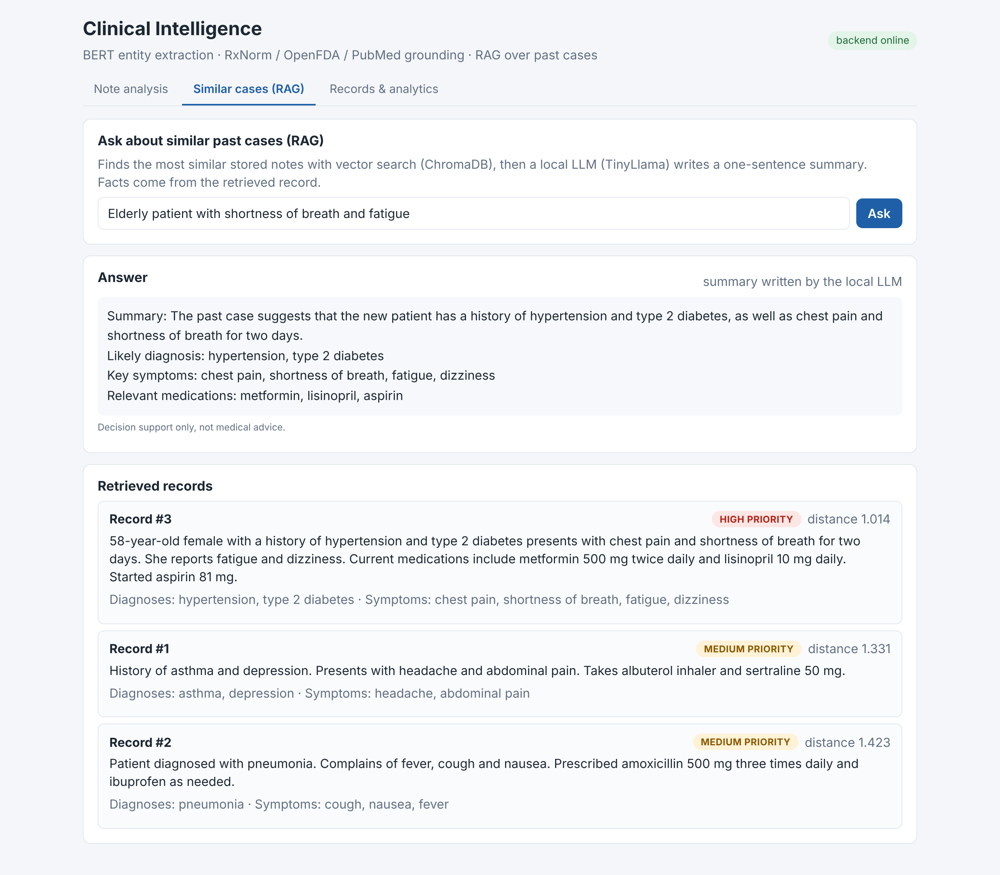
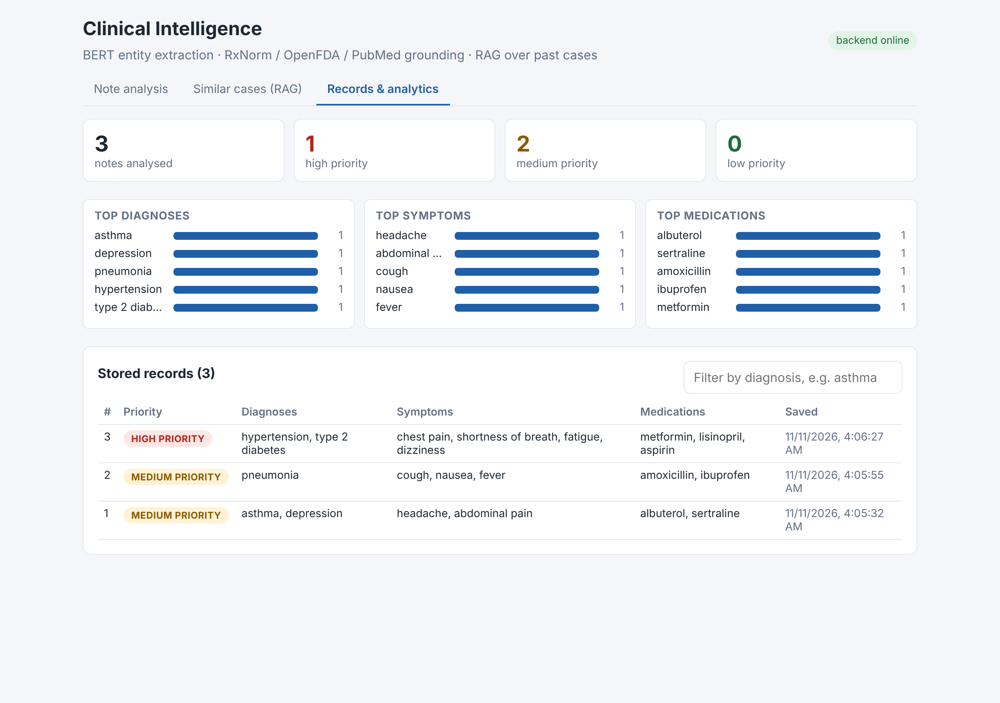

# Clinical Intelligence System

Full-stack AI application that turns an unstructured physician note into structured clinical insight. A transformer NER model extracts medications, doses, symptoms and diagnoses; each entity is grounded in **RxNorm**, **OpenFDA** and **PubMed**; every note gets a **severity flag**; notes are stored in SQLite and a **ChromaDB** vector index, and a **RAG** endpoint retrieves similar past cases and has a **local LLM** summarise them. A **React + TypeScript dashboard** ties it together.

> Built as a team project for the Saint Peter's University Academic Symposium.
> **My contributions:** the backend: BERT entity-extraction pipeline, FastAPI API, and PubMed / OpenFDA / RxNorm integration.



## How it works

```
clinical note
   │
   ▼
BERT NER  (d4data/biomedical-ner-all, Hugging Face)
   │  post-processing: rejoin split words, "chest" + "pain" → "chest pain",
   │  attach doses to drugs, drop generic words, dictionary safety net
   ▼
medications (+dose) · symptoms · diagnoses ──► severity flag (rule-based, with reasons)
   │
   ├─► RxNorm   normalise each drug to its RxCUI
   ├─► OpenFDA  single-ingredient drug label: indications, warnings
   └─► PubMed   most relevant article per condition / symptom / drug side effects
   ▼
SQLite (SQLAlchemy)  +  ChromaDB (all-MiniLM-L6-v2 embeddings)
   │
   ▼
RAG: vector search for similar cases → TinyLlama writes a one-sentence summary,
     grounding check rejects it if it mentions facts from another case
```

## Evaluation

30 hand-labelled clinical notes (133 entities, `evaluation/gold_notes.json`), BERT pipeline vs. a keyword baseline. Strict = exact match after normalisation; relaxed = one contains the other ("diabetes" ≈ "type 2 diabetes").

| Category | Precision | Recall | F1 (strict) | F1 (relaxed) | Keyword baseline F1 |
|---|---|---|---|---|---|
| Medications | 0.94 | 0.94 | **0.94** | 0.97 | 0.06 |
| Symptoms | 0.67 | 0.62 | **0.65** | 0.90 | 0.33 |
| Diagnoses | 0.75 | 0.64 | **0.69** | 0.89 | 0.16 |
| **Overall** | 0.76 | 0.71 | **0.73** | 0.91 | 0.22 |

```bash
python -m evaluation.evaluate      # writes evaluation/results.md
```

The notes were written for this evaluation and the code was not tuned on them afterwards. It is a small set, so treat the numbers as indicative.

## Dashboard (React + TypeScript)

| Tab | What it shows |
|---|---|
| **Note analysis** | Paste a note → severity badge with reasons, entities as chips (drugs with doses), RxNorm / OpenFDA drug cards, PubMed links, raw model output with confidence and source |
| **Similar cases (RAG)** | Ask a question → answer (LLM summary + facts from the best match) and the retrieved records with similarity distance |
| **Records & analytics** | Counts by priority, top diagnoses / symptoms / medications, record table with diagnosis filter |

<p>


</p>

## API

| Method | Path | What it does |
|---|---|---|
| POST | `/extract/from-note` | Full pipeline: NER → severity → RxNorm / OpenFDA / PubMed → SQLite + ChromaDB |
| POST | `/extract/context` | Grounding only, for entities you already have |
| POST | `/search/` | Vector search for similar stored notes |
| POST | `/rag/` | Similar cases + local-LLM summary |
| GET | `/records/` | Stored records (`diagnosis`, `symptom`, `medication`, `skip`, `limit`) |
| GET | `/records/{id}` | One record |
| GET | `/analytics/summary` | Totals, top entities, severity counts |
| GET | `/rxnorm/normalize`, `/openfda/drug`, `/pubmed/search` | Individual source lookups |
| GET | `/health/` | Health check |

Interactive docs: http://localhost:8000/docs

## Run it

Backend (Python 3.10+):

```bash
python -m venv .venv && source .venv/bin/activate
pip install torch --index-url https://download.pytorch.org/whl/cpu   # small CPU-only build
pip install -r requirements.txt
uvicorn backend.app.main:app --reload
```

Frontend (Node 18+), in a second terminal:

```bash
cd frontend
npm install
npm run dev          # http://localhost:5173
```

First use downloads the models: NER ~260 MB, embeddings ~90 MB, TinyLlama ~2.2 GB. Set `RAG_USE_LLM=0` to skip TinyLlama on a small machine. A note takes ~20–35 s to analyse, mostly PubMed (NCBI allows ~3 requests/second without an API key; the client retries on rate limits).

## Tests

```bash
pytest -q
```

13 tests run in under a second without internet: models and external APIs are replaced with recorded outputs. They cover entity clean-up, the dictionary safety net, the full pipeline with database save and retrieval, search, RAG and its grounding check, analytics, severity rules, input validation and PubMed retries. GitHub Actions runs them on every push.

## Limitations

- No negation handling: "denies fever" would still list fever.
- The NER model is general biomedical, not fine-tuned on clinical notes; symptoms are the weakest category (strict F1 above).
- Severity flags are simple transparent rules, not a validated triage score.
- TinyLlama is small; it writes only the summary sentence, and the structured facts come from the retrieved record.
- PubMed and OpenFDA results are pointers to sources, not clinical recommendations.

## Tech stack

Python · FastAPI · Hugging Face Transformers (BERT NER, TinyLlama) · Sentence-Transformers · ChromaDB · PyTorch · SQLAlchemy / SQLite · RxNorm, OpenFDA, PubMed (NCBI E-utilities) · React · TypeScript · Vite · pytest · GitHub Actions
